# Kedata Vibe Skills — Complete Pipeline Guide

A step-by-step guide to running the `vibeskills` collection end to end. It shows the
**order**, **what each skill produces**, which steps are **mandatory vs optional**, and
where the **flow branches** (architecture, backend stack, frontend stack, deployment).

> Legend — `[M]` Mandatory · `[O]` Optional · `[E]` External (not a skill) · `[S]` Stack-specific (pick one) · `[X]` Cross-cutting (runs anytime)

---

## 1. The Big Picture

The pipeline turns a raw idea (or an inherited codebase) into a reviewed, deployed pull
request. Each stage produces an artifact that the next stage reads. Nothing is improvised:
later stages **read** what earlier stages **approved** — they never re-interview the product.

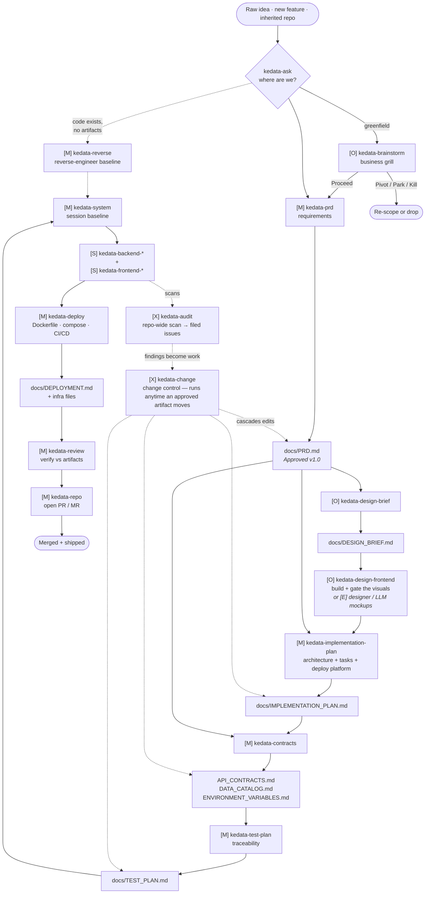

> `kedata-change` is a **loop**, not a stage: whenever an approved artifact must move
> (scope change, spec gap, hotfix), it runs first and cascades the change through the
> chain below it before work resumes.

> `kedata-audit` is the **proactive twin**: it scans the whole repo (not a diff) and files
> prioritized, deduplicated issues — those findings re-enter the flow as `kedata-change`
> requests or direct stack-skill fixes. It never gates a merge.

---

## 2. Artifact Dependency Graph

Which document feeds which. Arrows = "is read by".

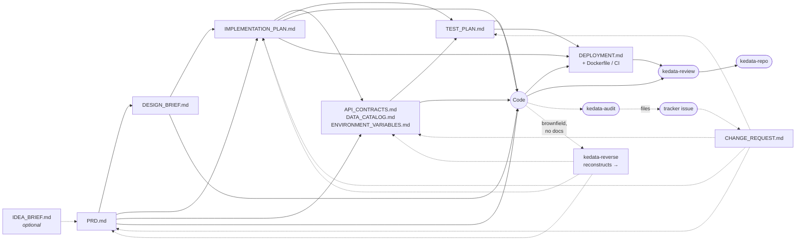

All artifacts live at `docs/<FILE>.md` first, falling back to the repo root
`<FILE>.md`. Once a file exists, later runs **update it in place** — never duplicate,
never move.

---

## 3. Step-by-Step Walkthrough

### Stage 0 — Orientation *(anytime)*

**`/kedata-ask`** — *"Where is this codebase?"*
- **Input:** nothing (inspects the repo itself).
- **Output:** a status report — current stage, next step, which skill to run.
- **Produces:** no artifact.
- **Use it:** when you're new to a repo or unsure what to do next. It never creates or edits anything.

---

### Stage 0.2 — Brownfield Onboarding `[M]` *(only if code exists without artifacts)*

**`/kedata-reverse`** — *existing code → reconstructed artifacts*
- **Input:** the codebase itself (routes, models/migrations, env reads), plus README/git history/tests.
- **Output:** reconstructed `docs/PRD.md`, `API_CONTRACTS.md`, `DATA_CATALOG.md`, `ENVIRONMENT_VARIABLES.md`, baseline `IMPLEMENTATION_PLAN.md`, and `docs/RECONSTRUCTION_REPORT.md`.
- **Method:** reverse-engineer the spec from code; tag every item **Observed / Inferred / Unknown**.
- **Gate:** artifacts start as **`Reconstructed`** (never `Approved`) until a human confirms the inferences.
- **When:** inherited/legacy repo, or a project started without the pipeline. This is the entry point `kedata-ask` routes you to when docs are missing.
- **Not for:** greenfield ideas (→ `kedata-prd`) or changing an already-approved PRD (→ `kedata-change`).

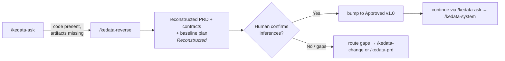

---

### Stage 0.5 — Idea Validation `[O]` *(before PRD)*

**`/kedata-brainstorm`** — *Raw idea → validated idea*
- **Input:** nothing mandatory (a raw idea).
- **Output:** `docs/IDEA_BRIEF.md`.
- **Grills:** problem, market, competition, value prop, business model, feasibility, GTM, kill criteria → a verdict.
- **Verdicts:** `Proceed` · `Pivot` · `Park` · `Kill`.
- **Optional?** Yes. If you're **already convinced** the idea is sound, **skip straight to `kedata-prd`**.
- **Not a gate:** `IDEA_BRIEF.md` is never a prerequisite for the PRD.

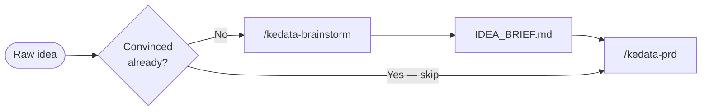

---

### Stage 1 — Requirements `[M]`

**`/kedata-prd`** — *the first source of truth*
- **Input:** optional `IDEA_BRIEF.md`; an issue/task description.
- **Output:** `docs/PRD.md` — 18 sections.
- **Method:** deep interview across 9 domains + a 16-point **edge-case sweep** (§18 register).
- **Gate:** status must reach **`Approved` v1.0** before anything downstream runs.
- **Key sections consumed later:** §5 ACs, §7 stack, §8 features, §9 API, §10 data, §12 env vars, §18 edge cases.

---

### Stage 2 — Design `[O]` *(recommended)*

**`/kedata-design-brief`** — *visual / UX context*
- **Input:** `PRD.md` (mandatory).
- **Output:** `docs/DESIGN_BRIEF.md` — 12 sections, no engineering detail.
- **Then:** visuals come from **`/kedata-design-frontend`** (in-collection, anti-slop art direction
  + real-browser gate) or, alternatively, from `[E]` external designer / LLM mockups.
- **Optional?** Technically yes — but required input for FE work. Without it, the FE follows plan + mockups only.

> **Companion — `kedata-design-frontend`.** This stage pairs with the vendored
> **`kedata-design-frontend`** (adapted from [tasteskill.dev](https://www.tasteskill.dev/), MIT —
> see `THIRD_PARTY_NOTICES.md`) for anti-slop art direction. Load it while grilling §1 Product
> Identity and §3 tokens so the brand personality and palette are *decided*, not defaulted, and
> again when the visuals are built. The approved `DESIGN_BRIEF.md` is the contract and wins on any
> conflict.

---

### Stage 3 — Planning `[M]`

**`/kedata-implementation-plan`** — *the product→engineering handoff*
- **Input:** `PRD.md` (**mandatory** — if missing, **STOP**), `DESIGN_BRIEF.md` (recommended).
- **Output:** `docs/IMPLEMENTATION_PLAN.md` — 12 sections.
- **Locks two expensive decisions:** architecture (§1) and deployment platform (§3).
- **Freezes scope** and breaks PRD features into ordered tasks with ACs, owner, effort, milestone.

#### Branch A — Architecture (plan §1)

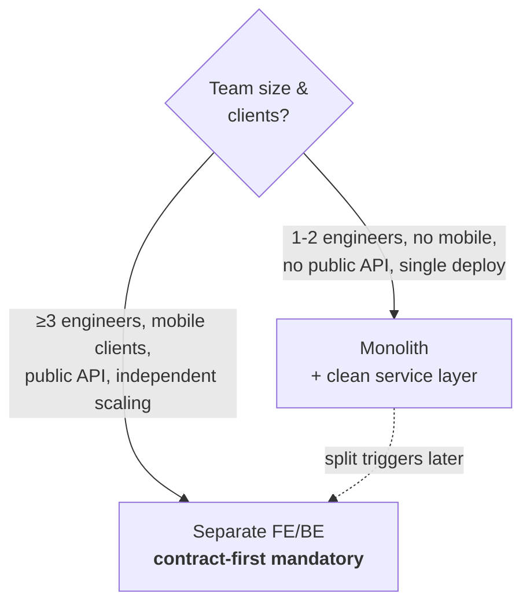

#### Branch B — Deployment platform (plan §3)

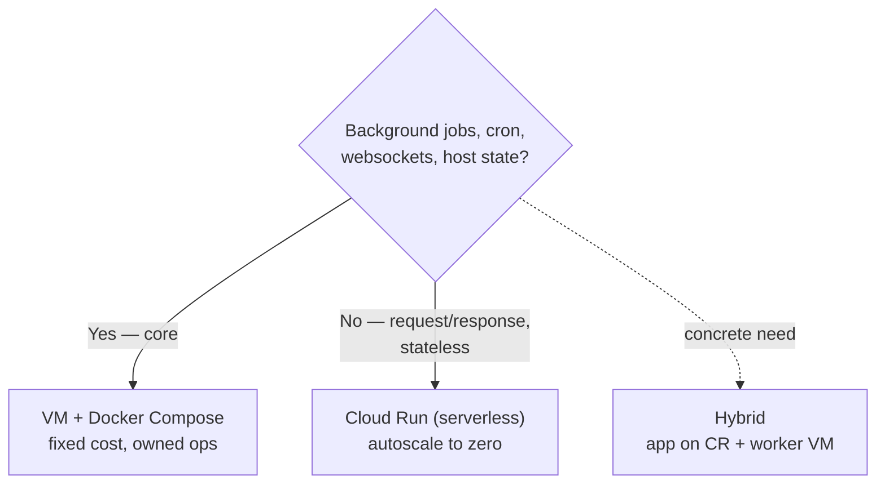

> Branch B decides the platform here; **`kedata-deploy`** (Stage 6.5) is what actually
> builds it.

---

### Stage 4 — Contracts `[M]`

**`/kedata-contracts`** — *engineering reference docs*
- **Input:** `IMPLEMENTATION_PLAN.md` (**mandatory** — if missing, **STOP**), `PRD.md` (context).
- **Output:** `docs/API_CONTRACTS.md` + `docs/DATA_CATALOG.md` + `docs/ENVIRONMENT_VARIABLES.md`.
- **Rule:** expands plan §6/§7/§8 into full shapes/codes/types — **adds no scope**.
- **When split FE/BE:** the API contract is the **first deliverable** and blocks both teams.

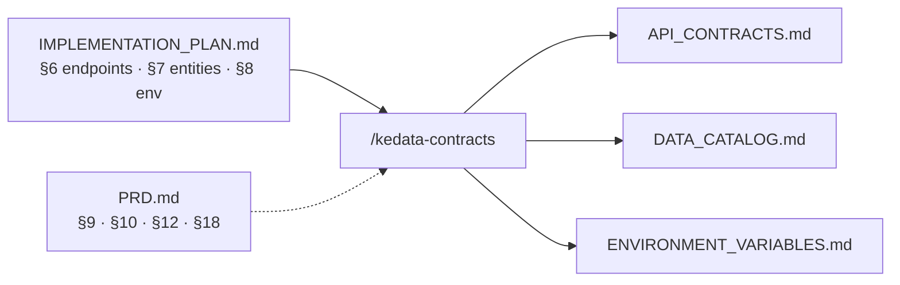

---

### Stage 4.5 — Test Plan `[M]`

**`/kedata-test-plan`** — *the traceability bridge from spec to tests*
- **Input:** `PRD.md` (mandatory — §5 ACs, §18 edge cases), `IMPLEMENTATION_PLAN.md` (mandatory — §4 testing strategy, §5 tasks, §10 DoD), contracts (mandatory).
- **Output:** `docs/TEST_PLAN.md` — strategy, traceability matrix, test cases, fixtures, environments, NFR tests, exit criteria.
- **Rule:** every AC and every P0 edge case maps to ≥1 test case; every case cites its source artifact.
- **Why:** it is the plan the stack skills implement **against** and `kedata-review` verifies **coverage** against.

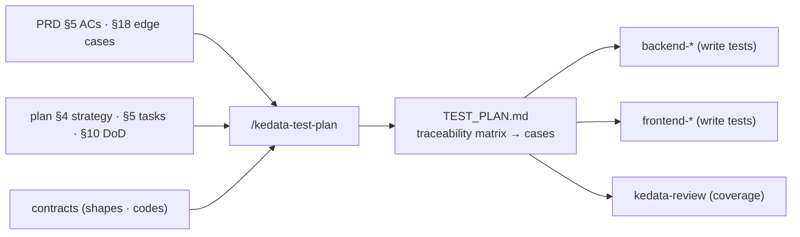

---

### Stage 5 — Engineering baseline `[M]`

**`/kedata-system`** — *session baseline*
- **Input:** all approved artifacts, read **in order**: plan → PRD → brief → contracts → issue.
- **Output:** **no artifact** — behavioral only (per-task plan + Changes Summary, both conversational).
- **Enforces:** read-before-you-code, plan → confirm → code → test → verify, security, git, deployment rules.
- **Stack discipline:** **reads** the stack from PRD §7 / plan §4 — if it's missing, **STOP and escalate**.
- **Bootstrap tip:** reference it from your repo's `AGENTS.md` so every session auto-loads it.

---

### Stage 6 — Implementation `[S]` *(pick per stack)*

Load **one backend skill** and/or **one frontend skill** matching the stack locked in plan §4.

```mermaid
flowchart TD
    SYS["/kedata-system<br/>baseline loaded"] --> B{"Backend stack<br/>(plan §4)?"}
    B -->|Go + Gin| GO["/kedata-backend-go"]
    B -->|Python + FastAPI| PY["/kedata-backend-python"]
    B -->|Node + Express| NODE["/kedata-backend-node"]
    B -->|Rust (Axum optional)| RUST["/kedata-backend-rust"]

    SYS --> F{"Frontend stack<br/>(plan §4)?"}
    F -->|React 19 + TanStack Start| REACT["/kedata-frontend-react"]
    F -->|Vue 3 + Nuxt 3| NUXT["/kedata-frontend-nuxt"]

    GO & PY & NODE & RUST --> REVIEW
    REACT & NUXT --> REVIEW
```

Each stack skill enforces its own mandatory standards (e.g. backend: Swagger/OpenAPI docs
+ activity logging; frontend: design-token fidelity + loading/error/empty states).

> **Companion — `kedata-design-frontend`.** Each `kedata-frontend-*` skill pairs with the vendored
> **`kedata-design-frontend`** (adapted from [tasteskill.dev](https://www.tasteskill.dev/)) for
> visual craft: use its page run for public pages, its `references/app-screens.md` for
> dashboards/admin, and run its `lint.mjs` / `inspect.mjs` gate (1440 / 768 / 390px) on public
> pages. It complements the brief's contract and never overrides it.

> **Companion — rust-expert-best-practices-code-review.** `kedata-backend-rust`
> ([wispbit-ai/skills](https://github.com/wispbit-ai/skills);
> `npx skills add https://github.com/wispbit-ai/skills --skill rust-expert-best-practices-code-review`)
> adds idiomatic-Rust rules — type safety, error handling, API design, quality, performance — for
> writing, refactoring, and reviewing Rust. It guides idiom only; the plan and contracts win.

---

### Stage 6.5 — Deployment `[M]`

**`/kedata-deploy`** — *turn the platform decision into runnable infrastructure*
- **Input:** `IMPLEMENTATION_PLAN.md` §3 (mandatory — platform + constraints; **STOP if "TBD"**), contracts (`ENVIRONMENT_VARIABLES.md`), `TEST_PLAN.md` (§7 CI gates).
- **Output:** `docs/DEPLOYMENT.md` runbook **+ generated infra**: `Dockerfile`(s), `docker-compose.yml` / Cloud Run config, CI/CD pipeline, `.dockerignore`, `.env.example`.
- **Rule:** reads the platform from plan §3 — **never re-decides it**. Enforces Cloud Run statelessness/timeout/jobs vs VM compose/patching/backups.
- **Why:** planning said *where it runs*; this makes it *actually run*, with rollout + rollback.

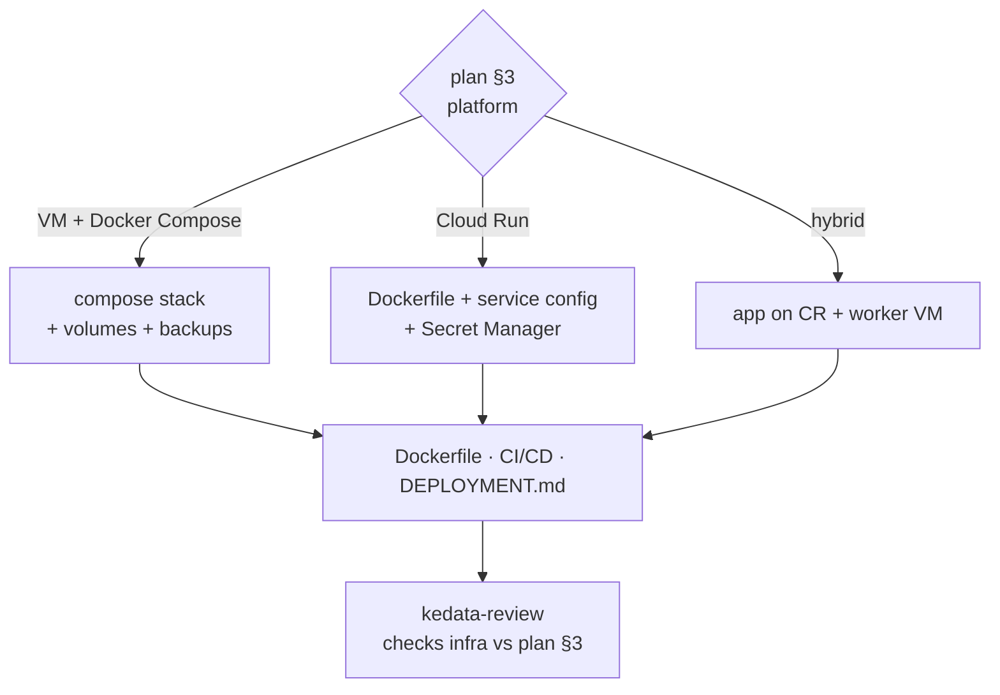

---

### Stage 7 — Review `[M]`

**`/kedata-review`** — *verify code against the artifacts*
- **Input:** `IMPLEMENTATION_PLAN.md`, `API_CONTRACTS.md`, `DATA_CATALOG.md`, `ENVIRONMENT_VARIABLES.md`, `PRD.md`, `DESIGN_BRIEF.md`, `TEST_PLAN.md`, `DEPLOYMENT.md`, and the PR diff.
- **Output:** a priority-ordered review: **contract → mandatory → recommended**.
- **Verdicts:** `Request Changes` · `Approve with Suggestions` · `LGTM`.
- **Rule:** any contract violation or failed mandatory check = **Request Changes**.

---

### Stage 8 — Repo communication `[M]`

**`/kedata-repo`** — *open the PR / MR*
- **Input:** the branch diff; approved artifacts; `scripts/repo-context.sh` (platform detection).
- **Output:** a PR (GitHub `gh`) / MR (GitLab `glab`) in the house template, linked to its issue.
- **Encodes** the mandatory checks checklist (Swagger, activity logs, secrets, tests, lint, build, docs).

---

### Cross-cutting — Change Control `[X]` *(runs anytime)*

**`/kedata-change`** — *keep the artifacts the source of truth*
- **Input:** the change request (stageholder change, spec gap, bug, hotfix) + all current artifacts.
- **Output:** `docs/CHANGE_REQUEST.md` (or `CHANGES.md`) **+ updates to affected artifacts** in cascade order with version bumps.
- **Classes:** `Minor` (one artifact) · `Medium` (PRD → plan → contracts → test plan) · `Major` (re-run stages → `kedata-prd` / `kedata-implementation-plan`) · `Hotfix` (ship first, reconcile docs after).
- **Rule:** a change to the PRD almost always touches the plan, contracts, and test plan — the cascade finds every one.

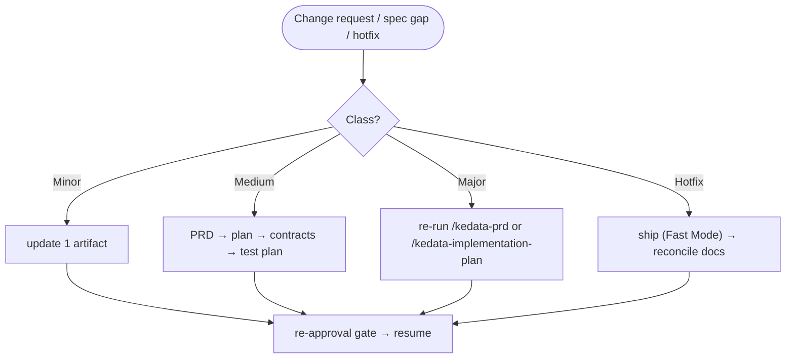

---

### Cross-cutting — Repo-wide Audit `[X]` *(proactive discovery)*

**`/kedata-audit`** — *scan the whole repo → file prioritized issues*
- **Input:** the entire codebase; the approved artifacts (to trace findings); the existing issue backlog (to dedupe).
- **Output:** `docs/AUDIT_REPORT.md` **+ filed GitHub/GitLab issues** (bugs, security, tech debt, test gaps, doc/deploy drift).
- **Method:** reuses the `kedata-review` checklist **repo-wide** (not a diff); dedupes against the tracker; files only above a severity threshold, after a **dry-run** confirmation.
- **Rule:** it **creates issues, it does not gate merges** — that is `kedata-review`. Fixes flow back through `kedata-change` / the stack skills.

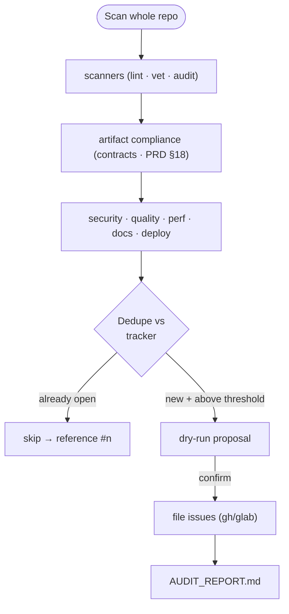

> Discovery is **proactive**: the pipeline fixes work already in flight; `kedata-audit` finds the work that *should* exist and puts it on the board. It never gates a merge.

> **Lean lens — `kedata-ponytail*`.** The vendored ponytail family (MIT — see `THIRD_PARTY_NOTICES.md`)
> is a cross-cutting discipline, not a stage. `/kedata-ponytail` (lite/full/ultra) sets how every stage
> is built: the smallest complete change. `/kedata-ponytail-review` pairs with `kedata-review` and
> `/kedata-ponytail-audit` pairs with `kedata-audit` — they ask whether every line earns its place, and
> they report only. Lean never overrides an approved artifact; shrinking one goes through `kedata-change`.
> `/kedata-ponytail-debt` lists the `shortcut:` deferrals left behind.

---

## 4. Full Linear View (the "golden path")

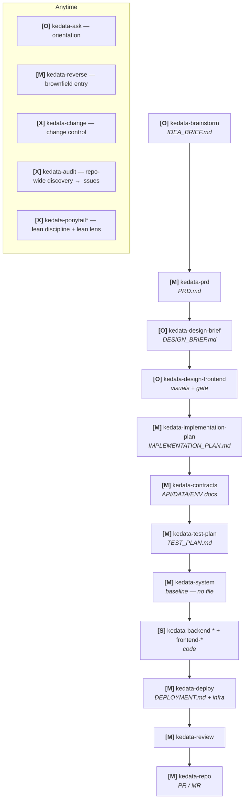

---

## 5. Quick Reference

| # | Skill | Status | Command | Input | Output artifact |
|---|-------|--------|---------|-------|-----------------|
| — | `kedata-ask` | `[O]` | `/kedata-ask` | repo state | none (report only) |
| 0.2 | `kedata-reverse` | `[M]`* | `/kedata-reverse` | existing code | `PRD.md`, contracts, baseline `IMPLEMENTATION_PLAN.md`, `RECONSTRUCTION_REPORT.md` |
| 0.5 | `kedata-brainstorm` | `[O]` | `/kedata-brainstorm` | raw idea | `IDEA_BRIEF.md` |
| 1 | `kedata-prd` | `[M]` | `/kedata-prd` | `IDEA_BRIEF.md`? | `PRD.md` |
| 2 | `kedata-design-brief` | `[O]` | `/kedata-design-brief` | `PRD.md` | `DESIGN_BRIEF.md` |
| 2.5 | `kedata-design-frontend` | `[O]` | `/kedata-design-frontend` | `DESIGN_BRIEF.md` + `PRD.md` | implemented visuals + inspector report (or `[E]` mockups) |
| 3 | `kedata-implementation-plan` | `[M]` | `/kedata-implementation-plan` | `PRD.md` + brief | `IMPLEMENTATION_PLAN.md` |
| 4 | `kedata-contracts` | `[M]` | `/kedata-contracts` | plan + PRD | `API_CONTRACTS.md`, `DATA_CATALOG.md`, `ENVIRONMENT_VARIABLES.md` |
| 4.5 | `kedata-test-plan` | `[M]` | `/kedata-test-plan` | PRD + plan + contracts | `TEST_PLAN.md` |
| 5 | `kedata-system` | `[M]` | `/kedata-system` | all artifacts | none (baseline) |
| 6 | `kedata-backend-*` | `[S]` | `-go`/`-python`/`-node`/`-rust` | plan §4 | backend code |
| 6 | `kedata-frontend-*` | `[S]` | `-react`/`-nuxt` | plan §4 + brief | frontend code |
| 6.5 | `kedata-deploy` | `[M]` | `/kedata-deploy` | plan §3 + contracts | `DEPLOYMENT.md` + `Dockerfile`/compose/CI |
| 7 | `kedata-review` | `[M]` | `/kedata-review` | artifacts + diff | review verdict |
| 8 | `kedata-repo` | `[M]` | `/kedata-repo` | diff + artifacts | PR / MR |
| — | `kedata-change` | `[X]` | `/kedata-change` | change request + artifacts | `CHANGE_REQUEST.md` + updated artifacts |
| — | `kedata-audit` | `[X]` | `/kedata-audit` | whole repo + artifacts + backlog | `AUDIT_REPORT.md` + GitHub/GitLab issues |
| — | `kedata-ponytail` | `[X]` | `/kedata-ponytail` | the task at hand | none (session discipline: lite/full/ultra) |
| — | `kedata-ponytail-review` | `[X]` | `/kedata-ponytail-review` | a diff | lean review report (pairs with `kedata-review`) |
| — | `kedata-ponytail-audit` | `[X]` | `/kedata-ponytail-audit` | whole repo | lean audit report (pairs with `kedata-audit`) |
| — | `kedata-ponytail-debt` | `[X]` | `/kedata-ponytail-debt` | `shortcut:` comments | ledger (optionally `docs/PONYTAIL_DEBT.md`) |
| — | `kedata-ponytail-gain` | `[X]` | `/kedata-ponytail-gain` | — | benchmark scoreboard (display only) |
| — | `kedata-ponytail-help` | `[X]` | `/kedata-ponytail-help` | — | reference card |

\* `kedata-reverse` is mandatory **only when** you enter a brownfield repo with missing artifacts; otherwise it is skipped entirely.

---

## 6. Rules of Thumb

1. **A `Draft` artifact never drives the next stage.** Wait for `Approved` (v1.0) before moving on. `Reconstructed` (from `kedata-reverse`) is not `Approved` until a human confirms.
2. **Read-only downstream.** Engineering, review, contracts, test-plan, and deploy **read** decisions — they never re-decide the stack, platform, or re-interview the product.
3. **Contract-first when split.** If plan §1 says separate FE/BE, `kedata-contracts` must finish before either side codes.
4. **No artifact, no start.** Missing `IMPLEMENTATION_PLAN.md` → engineering stops. Missing contracts → code stops. Missing plan §3 → deploy stops.
5. **Trace everything.** Test cases trace to ACs/edge cases; tasks trace to features; contract entries trace to the plan. Untraceable = scope creep.
6. **Change before you build.** If scope moves, run `kedata-change` FIRST (hotfix excepted), then resume — never let code lead the docs.
7. **Update in place.** Re-running a skill updates its existing file and bumps the version — never creates a second copy.
8. **Optional means optional.** `kedata-brainstorm`, `kedata-design-brief`, and `kedata-reverse` can be skipped (the last only if you already have artifacts) — but skipping the brief costs you the FE visual contract, and skipping the test plan costs you coverage proof.
9. **Review gates, audit discovers.** `kedata-review` blocks a merge against one diff; `kedata-audit` scans the whole repo and files issues — it never gates. Fixes found by an audit flow back through `kedata-change` / the stack skills.
